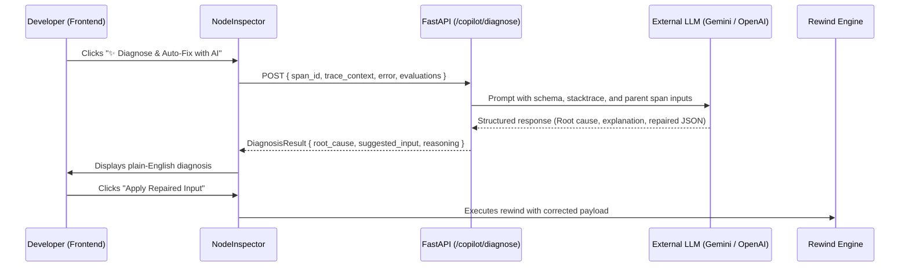

# Feature 02: AI Trace Copilot & Auto-Repair

**Status**: In Progress  
**Lead Component**: Backend & Frontend  
**Primary Files**:
- `backend/app/routers/copilot.py` (New endpoint `/api/v1/copilot/diagnose`)
- `backend/app/services/copilot_service.py` (LLM prompt engineering & diagnostic logic)
- `frontend/src/components/NodeInspector.tsx` (AI Diagnosis & Auto-Fix buttons)

---

## 1. Overview & Objective
Empower developers to troubleshoot agent failures instantly using an integrated AI Copilot. When a span fails or triggers warnings, the AI inspects the full trace context, pinpoints the root cause, and offers a 1-click repaired input payload for the Rewind mechanism.

---

## 2. Architecture & Data Flow



---

## 3. Implementation Blueprint

### Backend Endpoint: `POST /api/v1/copilot/diagnose`
**Request Body**:
```json
{
  "run_id": "uuid",
  "span_id": "uuid"
}
```

**Response Body**:
```json
{
  "summary": "The web search tool failed because the query contained invalid punctuation.",
  "root_cause_category": "tool_argument_error",
  "culprit_span_id": "uuid",
  "repaired_input": {
    "query": "Fix deployment authentication error"
  },
  "confidence_score": 0.95
}
```

### Frontend Integration
- Add a **"✨ AI Root Cause Diagnosis"** card inside `NodeInspector.tsx`.
- Include a **"⚡ Auto-Populate Repaired Input"** button directly connected to the Rewind mutation editor.

---

## 4. Teammate Checklist
- [ ] Create `backend/app/routers/copilot.py` and register in `backend/app/main.py`.
- [ ] Support fallback heuristic analysis if API keys are not supplied.
- [ ] Add loading skeletons and error banners in `NodeInspector.tsx`.
