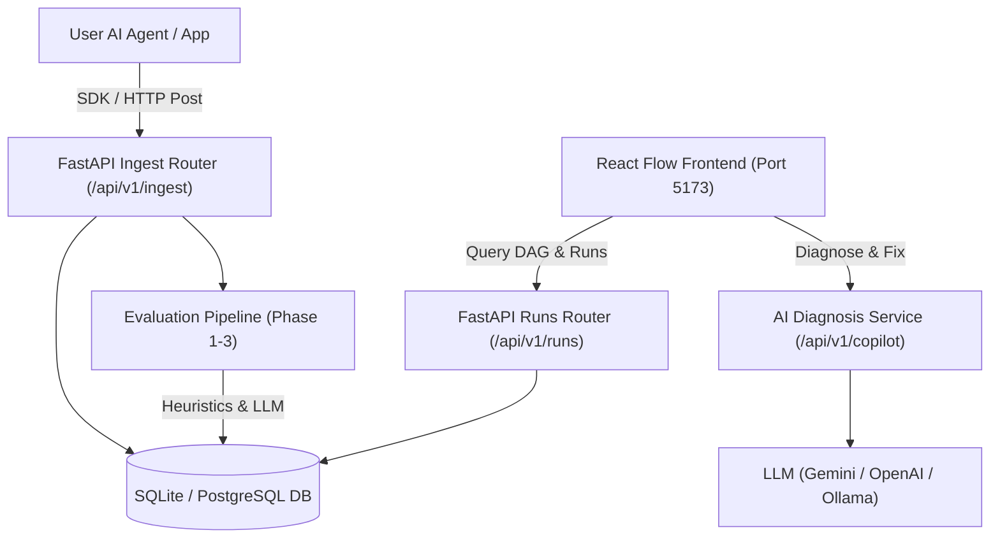

# Fathom Features & Architecture Roadmap

Welcome to the **Fathom** feature specification directory. This documentation is organized for teammates, contributors, and engineering leads to understand the current capabilities, upcoming AI features, and technical implementation blueprints.

---

## 🗺️ Feature Index

| # | Feature Name | Status | Technical Focus |
|---|--------------|--------|-----------------|
| **01** | [React Flow Trace DAG Visualizer](./01-react-flow-visualizer.md) | **Implemented** | Auto-layout (TB/LR), execution replay, bottleneck critical path, search |
| **02** | [AI Trace Copilot & Auto-Repair (Groq)](./02-ai-copilot-root-cause.md) | **Implemented** | Root-cause diagnosis with Groq Llama 3.3 70B, automated input mutation |
| **03** | [Active LLM-as-a-Judge Engine](./03-llm-judge-evaluations.md) | **Design / Partial** | Multi-model evaluation (Gemini/OpenAI/Ollama), semantic drift, RAG checks |
| **04** | [Cost, Token & Latency Analytics](./04-cost-latency-analytics.md) | **Planned** | Aggregated run metrics, cost heatmaps, P50/P95/P99 percentiles |
| **05** | [Python Tracing SDK & Integrations](./05-tracing-sdk-python.md) | **Planned** | 1-line `@fathom.trace` decorator, LangChain/LlamaIndex callback handler |

---

## 🏗️ System Architecture Overview

---

## 👥 Team Quickstart

- **Frontend Tech Stack**: React 18, `@xyflow/react` (React Flow), Tailwind CSS, Lucide Icons, Vite.
- **Backend Tech Stack**: FastAPI, SQLAlchemy, Pydantic v2, Uvicorn, SQLite/PostgreSQL.
- **Agent Sandbox**: Located in `agents/search_summarize_act.py` for testing scenarios (`success`, `tool_error`, `hallucination`, `bad_decision`).
